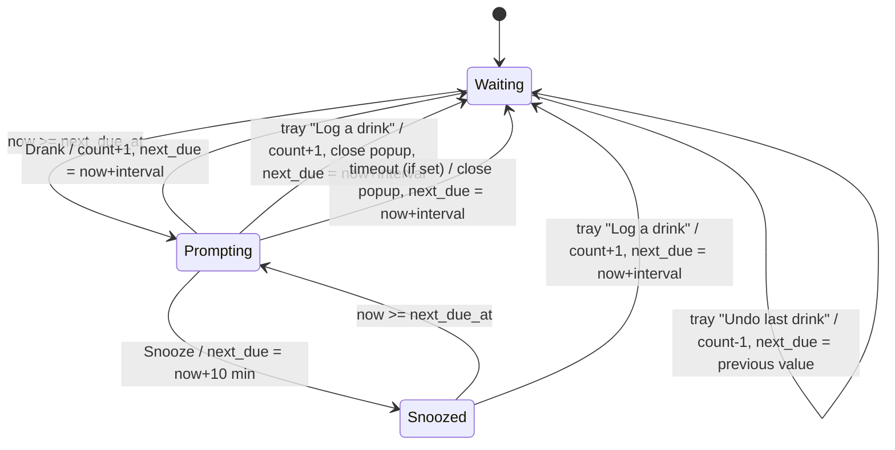

# State machines

## Reminder lifecycle

- **Wake from sleep:** if any due time passed while asleep, go to a single Prompting; missed reminders don't stack.
- **Day rollover:** on any tick or startup where the local date has changed, count → 0 and the undo history clears. A due time still ahead and a popup already on screen are kept; an overdue reminder left from yesterday is dropped (Waiting, next_due = now+interval), so a new day starts fresh. A popup open when the app quit is not on screen at startup, so it counts as overdue.
- **Prompting** holds until answered, unless the optional timeout is set.
- **How Prompting shows (release 2):** "close popup" above means closing whatever the reminder shows.
  - **Reminder style Popup (default):** entering Prompting shows the popup.
  - **Reminder style Small drop:** entering Prompting shows the drop. Clicking the drop swaps it for the popup without leaving Prompting, so the timeout still counts from when Prompting began.
  - **Shortcuts:** Drank, Snooze and their transitions are the same however the reminder looks, and the keyboard shortcuts (CAP-15) trigger the same Drank and Snooze. They are registered on entering Prompting and released on leaving it.
- **Undo** after a drink lands back in Waiting with the restored due time; if that time has already passed, the next tick prompts.
