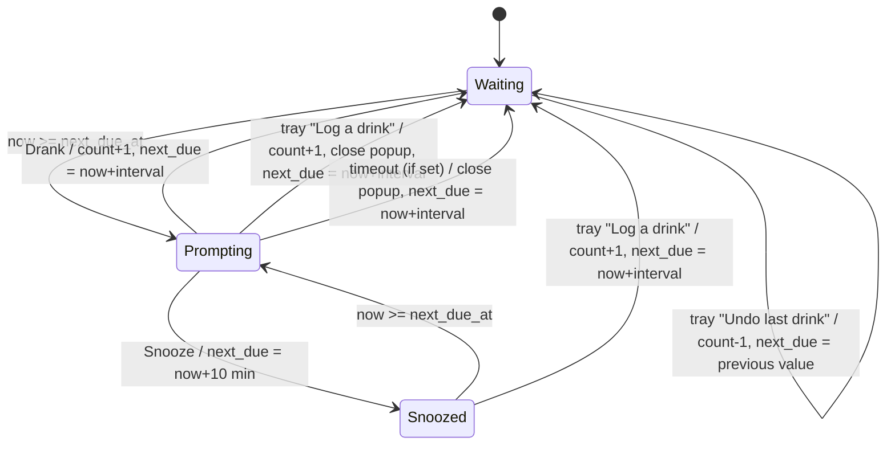

# State machines

## Reminder lifecycle

- **Wake from sleep:** if any due time passed while asleep, go to a single Prompting; missed reminders don't stack.
- **Day rollover:** on any tick or startup where the local date has changed, count → 0 and the undo history clears. The lifecycle state is unaffected.
- **Prompting** holds until answered, unless the optional timeout is set.
- **Undo** after a drink lands back in Waiting with the restored due time; if that time has already passed, the next tick prompts.
